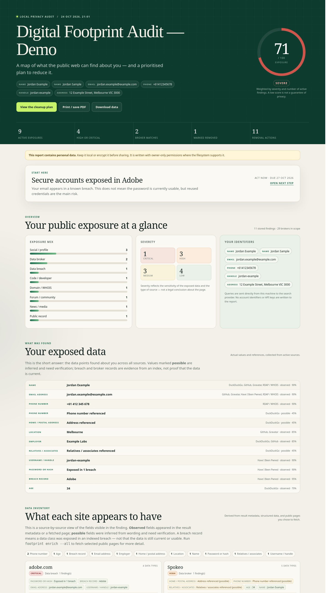

# Find My Footprint

**A local-first audit of your public digital footprint — and a practical plan to remove it.**

Find My Footprint searches public sources for the identifiers you choose (name, email, phone, usernames, address, domains), checks public profile and breach APIs, matches what it finds against a curated data-broker directory, and turns the result into a prioritised removal plan with official opt-out links and ready-to-edit request templates.

Everything is stored locally. No account, no cloud sync, no telemetry. The tool never submits an opt-out form for you, never logs in to a site, and never bypasses a CAPTCHA or access control.



> This is a self-audit tool. Only use it on yourself or on someone who has explicitly asked you to help. It is not a people-search or stalking tool, and it is not legal advice.

---

## Quick start: one command

```bash
cd Find_me

# 1. Install (Python 3.12+)
python3 -m venv .venv
. .venv/bin/activate
pip install -e .

# 2. Run the complete audit: profile, searches, checks, page enrichment,
#    named HTML report, removal plan, then clear profile.yaml.
footprint run --open
```

`footprint run` prompts for your name, email, phone, city and country if the profile is missing. You can also pass everything in one line:

```bash
footprint run \
  --name "Alex Example" \
  --email "alex@example.com" \
  --phone "+61 400 000 000" \
  --location "Melbourne, Australia" \
  --country Australia \
  --open
```

What the single command does, in order:

1. Creates or loads `profile.yaml` (`--fresh` to re-enter identifiers).
2. Builds the same searches and checks as the detailed workflow.
3. Fetches selected public result pages for evidence (`--no-enrich` to skip).
4. Writes `reports/<Your-Name>-footprint-report.html`.
5. Includes the removal plan, broker directory, and request templates in the report.
6. Clears `profile.yaml` unless `--keep-profile` is used.

No install? The module entry point works from the project root:

```bash
python3 -m footprint run --open
```

To see the full experience immediately, without any personal data or network requests:

```bash
footprint demo --open
```

This writes `reports/demo-report.html` using clearly labelled, reserved `example.com` data.

---

## What it actually checks

| Layer | What happens | Needs a key? |
|---|---|---|
| Web search | Exact-identifier queries through DuckDuckGo and Bing; optional Brave, Google CSE, SerpAPI, or Serper | No for DuckDuckGo/Bing |
| Manual search links | One-click Google/Bing/DuckDuckGo URLs for every planned query | No |
| Gravatar | Public profile lookup by email hash | No |
| GitHub / GitLab | Public profile, public email, bio, location | No (optional GitHub token raises rate limit) |
| Reddit / Keybase / Bluesky | Public profile lookups | No |
| npm | Public maintainer and package metadata | No |
| Breaches | Have I Been Pwned when keyed; otherwise the free XposedOrNot index | HIBP: yes |
| GitHub commits | Public commits whose author email matches yours | No (optional token) |
| GitHub name search | Public GitHub users whose profile name matches yours | No (optional token) |
| ABN Lookup | Exact-name matches in the Australian Business Register | No |
| Hudson Rock | Free infostealer index for the email address | No |
| Mastodon | Federated public account search by display name | No |
| OpenPGP | Public key directory lookup by email | No |
| RDAP / WHOIS | Public registrant data for your domains | No |
| Data brokers | Curated directory of official opt-out pages, by region | No |
| Removal channels | Google Results about you, Bing, DuckDuckGo, Internet Archive | No |

The audit deliberately does **not** collect passwords, credentials, private messages, login-gated content, or sensitive data from paid background-check reports.

### Matching is conservative

A result is stored only when every anchor in a query is visible in the title, snippet, or URL. `"Jordan Example" "Melbourne"` requires both the name and Melbourne. Results on data-broker domains are flagged more strongly. Username-only matches are kept low-confidence because handles are often reused by different people.

Every finding carries a confidence score, category, severity, and the evidence used. **Verify before acting.** If a match is a namesake, mark it `false_positive` so it stops appearing in your removal plan.

---

## Profile lifecycle and report naming

By default, a successful `scan` or `report` run **deletes `profile.yaml` after the report is written**. This is deliberate: it reduces the identifiers left at rest. The SQLite database, cache, and generated report remain; they are owner-only files.

- The report is named `reports/<Your-Name>-footprint-report.html` (for example, `reports/Alex-Example-footprint-report.html`).
- Use `--keep-profile` on `scan`, `report`, or `enrich` when you want to run follow-up commands such as `show`, `annotate`, `plan`, or `export`.
- After the profile is cleared, `footprint report --open` opens the most recent report. To run a new scan, run `footprint init` again.
- A failed or dry-run scan does not clear the profile, so you can retry safely.

The report and database still contain personal data. Clearing the profile is not a full data wipe; delete `.footprint/` and the generated report separately if you want to remove the local audit data.

## Privacy and safety model

- **Local files only.** The SQLite database, cache, profile, and report stay in your project directory.
- **Owner-only permissions.** The profile, database, and report are written `0600` where the filesystem supports it. The directories use `0700`.
- **No telemetry.** Nothing is sent back to the author.
- **Network disclosure is explicit.** Queries go directly from your machine to the search provider you choose. Those providers see the identifiers in the query and your IP address. Use a VPN if that matters.
- **HIBP is opt-in.** Breach checks only run when `HIBP_API_KEY` is set. That sends your email address to Have I Been Pwned.
- **No automated removal.** The tool produces links, text, and tracking commands. You review and submit each request yourself.
- **Rate limited.** Searches use a delay (minimum 1 second); the HTTP client also rate-limits per host and caches responses for repeat scans.
- **Redaction is best-effort.** `--redact` masks configured identifiers and snippets, but result URLs can still contain personal details. Review a redacted report before sharing it.
- **Consent matters.** Do not use this to build a profile of someone else without their permission.

If you are dealing with doxxing, stalking, threats, or identity theft, prioritize safety and evidence. Contact local support services and, where appropriate, police. Removing a page is not always the first step.

---

## Creating a profile

Interactive:

```bash
footprint init
```

Non-interactive:

```bash
footprint init \
  --name "Alex Example" \
  --email "alex@example.com" \
  --phone "+61 400 000 000" \
  --username "alex-example" \
  --location "Melbourne, Australia" \
  --country Australia
```

Or copy the example and edit it:

```bash
cp config.example.yaml profile.yaml
chmod 600 profile.yaml
$EDITOR profile.yaml
```

The profile supports:

```yaml
profile:
  display_name: "Alex Example"
  previous_names: ["Alex Sample"]
  emails: ["alex@example.com"]
  phones: ["+61 400 000 000"]
  usernames: ["alex-example"]
  addresses: ["12 Example Street, Melbourne VIC 3000"]
  locations: ["Melbourne, Australia"]
  websites: ["https://example.com"]
  domains: ["example.com"]
  country: "Australia"
```

Start with the minimum. Add a previous name or old username only if you are comfortable sending it to a search provider.

### What makes a good scan?

- **Email + username + city** gives a strong first pass.
- **Phone and full address** produce more sensitive results and more false positives; add them if the risk justifies it.
- **One identifier at a time** is often better than dumping every historical detail into one profile. You can edit the file and re-scan.

---

## Commands

```text
footprint run                  One command: profile + scan + enrich + report
footprint run --fresh          Re-enter identifiers before the one-command run
footprint run --keep-profile   Keep profile.yaml after the one-command run
footprint init                 Create a private profile.yaml (advanced)
footprint searches             Print exact Google/Bing/DDG links to open yourself
footprint scan                 Search public sources and store findings
footprint scan --dry-run       Show queries without making requests
footprint scan --only checks   Run profile/breach/WHOIS checks only
footprint scan --only search   Run web search only
footprint scan --offline       Reuse cached responses only
footprint report               Generate <Name>-footprint-report.html
footprint report --open        Open the existing report if the profile was cleared
footprint report --redact      Mask identifiers in the report
footprint enrich --all         Fetch active result pages for detailed evidence
footprint enrich 2 5           Enrich specific findings
footprint scan --enrich        Scan, then fetch result pages automatically
footprint scan --keep-profile  Keep profile.yaml after the run
footprint report --keep-profile Keep profile.yaml after the report
footprint add-url <url>        Track a result you found in a browser
footprint annotate <id>        Record fields you can see on a site manually
footprint findings             List stored findings
footprint show <id>            Show what one source appears to have
footprint show <id> --json     Raw JSON record
footprint update <id> ...      Track a finding's status
footprint plan                 Print the prioritised removal plan
footprint brokers              List the removal directory
footprint broker-update ...    Track a broker opt-out
footprint export               Export JSON or CSV (CSV includes detected data points)
footprint doctor               Check dependencies, config, keys, and network
footprint demo                 Generate a safe sample report
```

### Recording fields you can see yourself

Some sites block automated fetches. If you can see the profile in a browser, record the fields manually:

```bash
footprint annotate 2 \
  --field employer=Example Labs \
  --field phone=+61 412 345 678 \
  --field "address=12 Example Street, Melbourne" \
  --evidence "Visible on the public profile page" \
  --notes "Verified while logged out"
```

Use `--possible` when a field is inferred rather than confirmed. Annotated fields appear in the report’s data inventory and site dossiers with the same observed/possible distinction.

### Getting the details a site actually shows

Search snippets only reveal a little. To fetch the public result pages and extract structured data, visible fields, and short evidence excerpts:

```bash
# Enrich all active findings (one public request per result page)
footprint enrich --all

# Or a specific finding
footprint enrich 2 --force

# Scan and enrich in one pass
footprint scan --enrich --enrich-limit 20
```

The enricher:

- fetches only public HTTP(S) pages;
- never logs in, bypasses a CAPTCHA, or accesses a private page;
- extracts JSON-LD/microdata fields, headings, meta descriptions, `mailto:`/`tel:` links, and short excerpts;
- stores selected fields and excerpts locally, not the full page;
- records HTTP 403/blocks honestly instead of inventing data;
- sends the page a request from your IP address — use `footprint enrich` deliberately.

After enrichment, the report’s **Data inventory** and **site dossiers** show what each site appears to have. Run `footprint report --open` again.

### Adding a result found in Google

If a browser search finds a page the automated engines missed, add it directly:

```bash
footprint add-url "https://www.zoominfo.com/p/Example-Person/123456" \
  --title "Example Person — ZoomInfo" \
  --snippet "Job title and work email" \
  --status confirmed \
  --notes "Found via Google; verified it is me"
```

The URL is checked for safety, the domain is matched against the broker directory, and the result flows into the report and removal plan. Use `--fetch` to pull the page and extract detailed evidence automatically. This is the most reliable path when a search engine blocks automated requests.

### Tracking progress

```bash
# You submitted a broker opt-out
footprint update 4 --status removal_requested --notes "Submitted 21 Oct, ref 12345"

# The listing is gone
footprint update 4 --status removed --notes "Confirmed by email 12 Nov"

# A previously removed listing came back (a re-scan also marks this automatically)
footprint update 4 --status reappeared

# A match was a namesake
footprint update 7 --status false_positive --notes "Different person in Ireland"

# Broker-level tracking
footprint broker-update spokeo --status removal_requested --due 2026-11-20
footprint broker-update spokeo --status removed
```

Finding statuses: `new`, `confirmed`, `removal_requested`, `removed`, `reappeared`, `monitoring`, `false_positive`.

Broker statuses: `not_checked`, `no_listing`, `listed`, `removal_requested`, `removed`, `blocked`.

The HTML report's checkboxes are a browser convenience. The CLI is the source of truth: the report displays the status stored in SQLite.

---

## Reading the report

`footprint report` writes a single self-contained HTML file (no external fonts or scripts) with:

- a weighted exposure score and severity/category breakdown;
- a **data inventory** showing which data types appear across all sources (name, email, phone, address, date of birth, employer, job title, relatives, passwords, and more);
- **site-by-site dossiers** that group findings by domain and show what that source appears to have;
- per-finding “What this source appears to show” chips with observed versus possible fields;
- detailed breach tables with breach name, date, record count, and exposed data classes;
- every finding with evidence, confidence, source, and tracking command;
- collapsible one-click links to run the exact queries in Google, Bing, and DuckDuckGo;
- low-confidence flags for name-only, country-only, and platform-probe matches;
- a prioritised removal plan;
- a region-filtered data-broker directory;
- a hardening checklist with local checkboxes;
- copyable GDPR, UK GDPR, CCPA/CPRA, Australian privacy, publisher, and search-engine request templates;
- a downloadable JSON copy of the report data;
- print/PDF styles.

The report contains personal data. Keep it local, or use `--redact` and still review URLs before sharing. The downloadable JSON is equally sensitive.

### How the score works

The score is a soft-saturation curve over the severity weights of **active** findings. Removed and false-positive findings do not count. It is a triage aid, not a security rating: one critical breach can matter more than dozens of low-signal mentions.

---

## Optional API keys

Keys are read from environment variables and are never written to the profile or report:

```bash
export HIBP_API_KEY="..."                 # Have I Been Pwned breach checks
export GITHUB_TOKEN="..."                 # higher GitHub API rate limit
export BRAVE_SEARCH_API_KEY="..."         # Brave Search API
export GOOGLE_CSE_API_KEY="..."           # Google Programmable Search
export GOOGLE_CSE_ID="..."
export SERPAPI_API_KEY="..."              # SerpAPI (Google results)
export SERPER_API_KEY="..."               # Serper (Google results; free tier)
```

Enable optional engines in `profile.yaml`:

```yaml
search:
  engines:
    - duckduckgo
    - bing
    - serper
```

For most people, DuckDuckGo plus manual checks in Google and Bing is enough. Paid search APIs improve coverage and reduce bot-check friction.

### Have I Been Pwned and the free fallback

Set `HIBP_API_KEY` and keep `checks.breaches: true` for the most established breach dataset. The scan sends each email to `haveibeenpwned.com` and stores only breach metadata: name, date, affected account count, and data classes. It never stores passwords.

Without an HIBP key, the scanner uses the free [XposedOrNot](https://xposedornot.com/) breach index if `checks.xposedornot` is enabled. That means your email is sent to XposedOrNot instead. Set `xposedornot: false` if you do not want that. HIBP remains the preferred source.

---

## Data broker directory

The directory lives in [`footprint/data/brokers.yaml`](footprint/data/brokers.yaml). It contains official opt-out and privacy pages, region labels, process notes, difficulty, estimated time, and domains used to classify search results.

- Default regions are `AU` and `GLOBAL`; add `US` and `UK` for other jurisdictions.
- Credit-bureau entries are marked as credit bans, not deletions. A credit ban restricts access to your credit file while active; it is not routine footprint cleanup.
- Some sites block automated link checks (HTTP 403) but work in a normal browser.
- Opt-out processes change. The links were checked around **2026-10-23**, but verify the destination before submitting identity documents.
- The tool does not pay, subscribe to, or submit anything on your behalf.

To add an operator, append an entry and run `footprint brokers`:

```yaml
- id: example-broker
  name: Example Broker
  regions: [AU]
  category: people_search
  domains: [example-broker.com]
  optout_url: https://example-broker.com/opt-out
  method: web form
  difficulty: medium
  minutes: 10
  requirements: Profile URL and email
  notes: Recheck after 30 days.
```

---

## Removal workflow that actually works

1. **Triage.** Mark namesakes as `false_positive`. Start with critical contact data and breach exposure.
2. **Remove at the source.** A broker opt-out or site deletion is more durable than a search-engine de-index.
3. **Refresh search indexes.** After a page changes or disappears, use Google's outdated-content tool and Bing's content removal.
4. **Use the right legal route.** GDPR/UK GDPR erasure, CCPA/CPRA deletion, or an Australian privacy request. Australia has no general right to erasure; ask for access, correction, and opt-out, and use the applicable credit reporting or privacy scheme.
5. **Keep evidence.** Save the URL, date, screenshot, confirmation, and reference number.
6. **Follow up.** Recheck after 14–30 days and again quarterly. Broker records get rebuilt from public records.
7. **Reduce future exposure.** Password manager, passkeys/MFA, SIM lock, email aliases, social privacy, metadata stripping, credit ban if identity data leaked.
8. **Re-scan.** `footprint scan` preserves statuses, flags reappeared findings, and keeps history.

A recurring monthly or quarterly scan is more useful than a one-off purge:

```cron
# Every quarter, at 09:00 on the first day of the month
0 9 1 */3 * cd /path/to/Find_me && .venv/bin/footprint scan --no-report >> .footprint/cron.log 2>&1
```

---

## Additional discovery techniques now included

- **Name → GitHub profile:** GitHub user search finds accounts whose profile name matches yours even when the username is unknown. This found a public profile during the last audit that username guessing missed.
- **Name → Australian Business Register:** exact-name ABN matches add business/entity records and registered localities.
- **Email → infostealer index:** Hudson Rock checks whether saved credentials associated with the email appeared in malware logs.
- **Name → Mastodon:** federated account search by exact display name.
- **Email local part → handle variants:** handles such as `john.smith`, `johnsmith`, and `john-smith`.
- **Phone variants:** national and E.164 formats plus name + phone.
- **Page evidence:** opt-in extraction of JSON-LD, microdata, contact links, headings, and excerpts.
- **Manual browser searches:** Google/Bing links and `add-url`/`annotate` for blocked sites.

These are additions, not a guarantee of completeness. Search-engine coverage and data-broker access remain the limiting factors.

## Why a first scan can return nothing

Free HTML search endpoints are hostile to automation. DuckDuckGo may serve a bot challenge, Bing may return unrelated results when it has no exact match, and Google blocks direct HTML scraping. The scanner now:

1. Retries transient network failures.
2. Falls back from DuckDuckGo to Bing automatically.
3. Searches broad name-only, name + country, name + email-handle, and platform-specific queries.
4. Runs profile, GitHub commit, OpenPGP, and breach checks that do not depend on a web index.
5. Prints `footprint searches` links so you can open the exact queries in a real browser, where Google works normally.
6. Shows manual Google/Bing/DuckDuckGo links in the HTML report.
7. Lets you add any result you find with `footprint add-url`; it is classified, matched to the broker directory, and included in the report and removal plan.

For reliable unattended Google coverage, set `SERPER_API_KEY` or `SERPAPI_API_KEY` and add the engine to `search.engines`:

```yaml
search:
  engines:
    - serper
    - duckduckgo
```

Serper has a free tier; SerpAPI and Google CSE have free quotas. This avoids scraping and bot challenges. If you cannot use an API, `footprint searches` and `footprint add-url` are the supported workflow.

## Limitations

- Search engines return a sample, not the whole web. Run more queries or check Google/Bing manually.
- A zero-result scan means the free index did not expose a matching page; it does not prove there is no footprint.
- HTML search engines can block an IP or serve degraded results. Use an API key or the manual links when that happens.
- Private accounts, paid reports, mobile apps, loyalty schemes, government databases, and offline data are outside this tool.
- Username and name matches can be another person.
- Breach data tells you an email appeared in a breach, not that the password still works.
- Data-broker coverage is curated, not exhaustive, and varies by country.
- RDAP/WHOIS lookups only cover domains you list.
- The tool does not delete anything for you and does not guarantee removal.
- XposedOrNot and Hudson Rock are free third-party indexes, not Have I Been Pwned. Set `HIBP_API_KEY` for the more established breach source.
- Hudson Rock matches malware-exposed credentials to an email; it does not prove the email owner’s current computer is infected. Use its evidence as a prompt to change reused passwords and scan devices.
- Redaction is best-effort; URLs may still identify you.
- Legal rights vary. This is not legal advice.

---

## Development

```bash
python3 -m venv .venv
. .venv/bin/activate
pip install -e .
python3 -m unittest discover -v
```

Project layout:

```text
footprint/
  cli.py          command-line interface
  config.py       profile validation and paths
  data_points.py  data-type inference and site inventory
  enrich.py       opt-in public page evidence extraction
  db.py           SQLite findings, runs, broker status
  search.py       search-engine adapters
  queries.py      query planning and conservative matching
  analyze.py      classification, severity, deduplication
  checks.py       public profile / breach / RDAP checks
  brokers.py      removal directory
  playbook.py     prioritised actions, checklists, templates
  report.py       self-contained HTML report
  demo.py         safe sample data
  data/
    brokers.yaml
tests/            66 offline unit tests
config.example.yaml
```

Tests are offline: they cover parsing, query matching, deduplication, SQLite state transitions, plan generation, HTML escaping, and redaction. Live scanners are not exercised by the default test suite.

---

## Research basis

The discovery and removal workflow is based on public documentation from the operators themselves:

- [Google: find and remove personal information from Search](https://support.google.com/websearch/answer/12719076)
- [Google Results about you](https://myactivity.google.com/results-about-you)
- [Bing content removal](https://www.bing.com/webmasters/tools/contentremoval)
- [DuckDuckGo content removal](https://duckduckgo.com/duckduckgo-help-pages/company/removing-content)
- [Australian Privacy Principles / OAIC](https://www.oaic.gov.au/privacy/your-privacy-rights/)
- [Have I Been Pwned](https://haveibeenpwned.com/)
- [XposedOrNot free breach API](https://xposedornot.com/api_doc)
- [GitHub commit search syntax](https://docs.github.com/en/search-github/searching-on-github/searching-commits)
- [GitHub user search](https://docs.github.com/en/rest/search/search#search-users)
- [ABN Lookup](https://abr.business.gov.au/)
- [Hudson Rock free tools](https://www.hudsonrock.com/free-tools)
- [Mastodon search API](https://docs.joinmastodon.org/methods/search/)
- [ZoomInfo privacy center](https://www.zoominfo.com/trust-center/your-privacy)
- [Serper Google search API](https://serper.dev/)

Search-engine HTML endpoints are best-effort. The tool is designed to fall back to manual search links and user-added URLs rather than pretending a blocked scrape is a complete audit.

## Legal and ethical use

This project is for understanding and reducing **your own** public exposure, or helping someone who has asked you to help. Do not use it to harass, stalk, dox, or build profiles of people without consent. Respect website terms, robots directives, rate limits, and privacy law. When in doubt, stop and ask.

MIT licensed.
